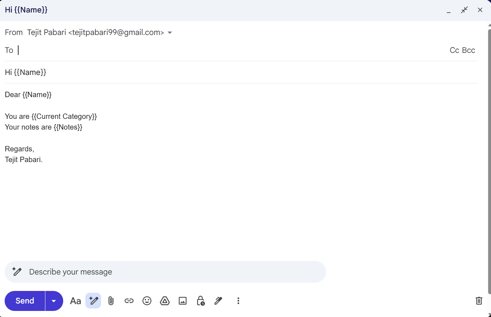
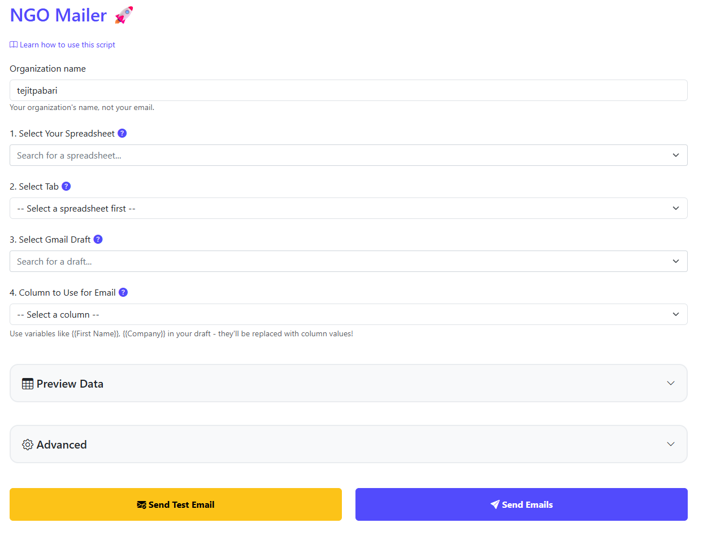
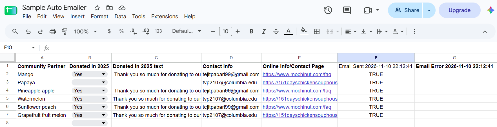

<!--  -->
# NGO Auto Emailer — Setup and Use

**Open the tool:** <https://go.tejitpabari.com/tejit-np-auto-emailer>

Nothing to download. It is a web page that runs inside your own Google account.

## What it does
Sends one personal email to many people at once. You write the email once in Gmail, mark the parts that change (like `{{Full Name}}`), and the tool fills in each person's details from your Google Sheet. Emails go out from your own Gmail address.

## What you need

| You need | What it means |
|---|---|
| A Google account | Gmail, personal or Google Workspace. |
| A Google Sheet | Your list. One row per person, with a column of email addresses. |
| A Gmail draft | An email saved in Gmail but **not** sent. It is your template. |

Google daily limits: about 100 emails (personal Gmail), about 1,500 (Workspace). Send bigger lists in batches over several days.

## Step 1 — Set up your sheet
- Put column names in **row 1** (for example `Full Name`, `Email`). One person per row from row 2.
- It must be a real **Google Sheet**, not `.xlsx` or `.csv`. For an Excel file: **File → Save as Google Sheets**.
- Cells are sent as plain text. Put links and formatting in the Gmail draft.

| Full Name | Email | Personal Note |
|---|---|---|
| Donor A | donor.a@example.com | Nice meeting you at the fundraiser. |
| Donor B | donor.b@example.com | |
| Donor C | donor.c@example.com | Great to see you at the gala. |

Example file: [sample-sheet.csv](docs/sample-sheet.csv) (**File → Import → Upload**).

## Step 2 — Write your Gmail draft
1. In [Gmail](https://mail.google.com), click **Compose**. Leave **To** empty.
2. Use a subject **no other draft has**. The tool finds your draft by subject.
3. Where a person's details go, type the column name in double curly brackets, for example:
```
Subject: Thank you, {{Full Name}}
Dear {{Full Name}},
{{Personal Note}} Thank you for your support this year.
```
- Use the column name **exactly** as in row 1, with no spaces inside the brackets: `{{Full Name}}`, not `{{ Full Name }}`.
- A placeholder in the subject is only filled in if the same `{{...}}` is also in the body.
- Attachments and pictures are sent to everyone.



## Step 3 — Open the tool and allow access (first time only)
Open the tool link. Google shows an "unverified" warning because the tool has not paid for Google's public review. It is safe if you trust the person who shared it.
**Safety check:** continue only if Google shows the developer as **tejitpabari99@gmail.com**. If not, click **Back to safety**.

1. Click **Review permissions**.

   

2. Click **Advanced** (small link, bottom left).

   

3. Click **Go to NGO Mailer (unsafe)**.

   

4. Tick **Select all**. The tool will not work if any box is left unticked.

   

5. Scroll to the bottom of the screen and click **Continue**.

| Google asks to… | Why |
|---|---|
| See your Google Drive files (read only) | To list your spreadsheets and read the one you pick. |
| View your email messages and settings (read only) | To find your draft. Nothing else is read. |
| Send email on your behalf | To send the emails from your address. |
| See, edit, create and delete your spreadsheets | To read your list and write "Email Sent" results back. |
| See your primary Google Account email address | To send the test email to you. |
| Connect to an external service | Only used to send anonymous usage counts to ping.tejitpabari.com. Never your emails, drafts or sheet content. |

## Step 4 — Fill in the dashboard



- **Organization name** — your organization's name, not your email. Required before any test or real send. It is remembered for next time.
- Pick your **spreadsheet**, the **tab** with your list, your **Gmail draft** (Step 2), and the **column** with email addresses.

## Step 5 — Send a test, then send

1. Click **Send Test Email**. One email goes **only to you**, using row 2's details (subject starts **[TEST]**). Check every `{{...}}` was replaced; if not, see [Troubleshooting](#troubleshooting).
2. Click **Send Emails**, then **OK**.
3. **Keep the tab open until it says Complete!** Closing it or letting the computer sleep stops sending.

With **Store results in spreadsheet** on (default), your tab gets new **Email Sent** and **Email Error** columns.



## Advanced options
Click **Advanced** on the dashboard. All optional.


| Option | What it does |
|---|---|
| **Start from Row** | Starts at this person (`1` = first person, row 2). Blank = from the top. |
| **Limit Emails** | Stops after this many tries. Blank = no limit. |
| **Conditional Column** | A column saying who already got the email. **TRUE** = skip. FALSE or empty = send. Other values stop the run. |
| **Store results in spreadsheet** | Adds **Email Sent** and **Email Error** columns (with date and time) each run. |

If 5 emails in a row fail, the tool stops. To continue after stopping:

- Set **Start from Row** to the next person after the last one sent, **or**
- Keep your own column (for example `Already Sent`), copy TRUE values into it after each run, and use it as the **Conditional Column**.

Do **not** use the newest **Email Sent** column alone as the Conditional Column. People skipped in that run are not in it, so they would be emailed again. After changing columns, refresh the page and re-pick your spreadsheet.

## Troubleshooting

| Problem | What to do |
|---|---|
| Sheet not in the list | Only 50 sheets are shown. Copy it (**File → Make a copy**) or remove old sheets, then refresh. Make sure it is not `.xlsx`. |
| "Draft … not found" | Check it is still in Gmail **Drafts** and no other draft shares its subject. Refresh. |
| `{{...}}` came out blank | Name does not match row 1 (check spelling, no inner spaces), the cell is empty, or it is only in the subject. |
| Quota or limit error | Daily Google limit reached. Wait 24 hours, then continue. |
| "Authorization required" | Open the tool link and repeat Step 3. Tick **Select all**. |
| Stopped after 5 errors | Read the last error and the **Email Error** column, fix it, then continue. |

## Privacy
- The tool runs **as you**, from your own Google account.
- It sends **anonymous usage counts** to the developer, including your **organization name**. Never your email address, names, recipients, or draft or sheet content.
- Read the [Privacy Policy](https://github.com/tejitpabari99/tejit-np-auto/blob/main/PRIVACY.md) and [Terms and Conditions](https://github.com/tejitpabari99/tejit-np-auto/blob/main/TERMS.md).
- Remove access any time at <https://myaccount.google.com/permissions> (look for **NGO Mailer**).
<!--  -->
