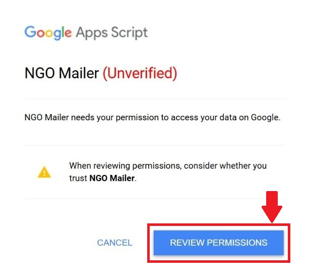
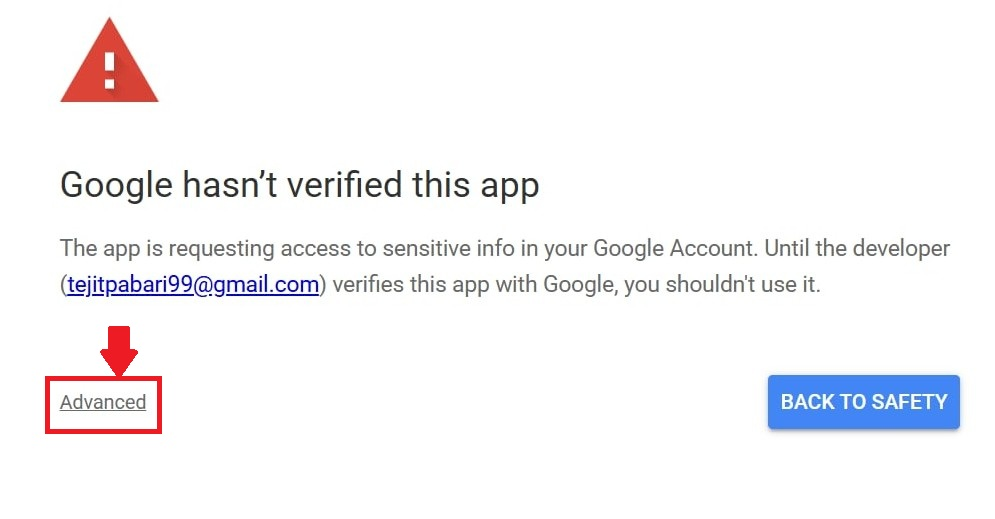
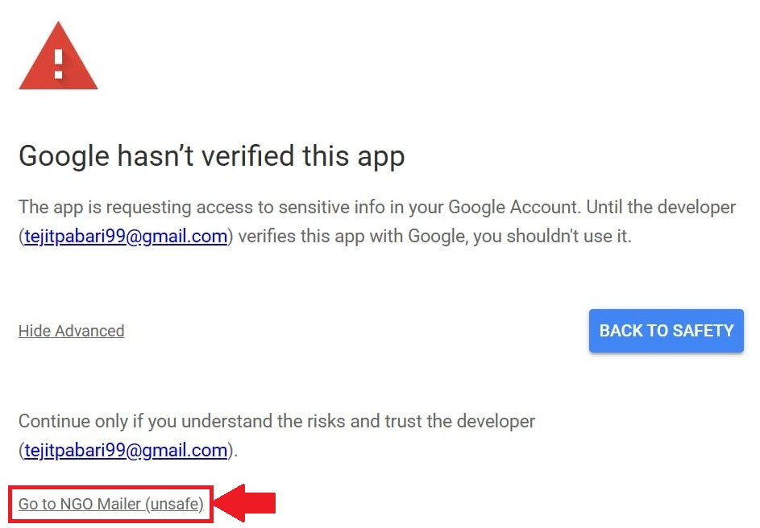
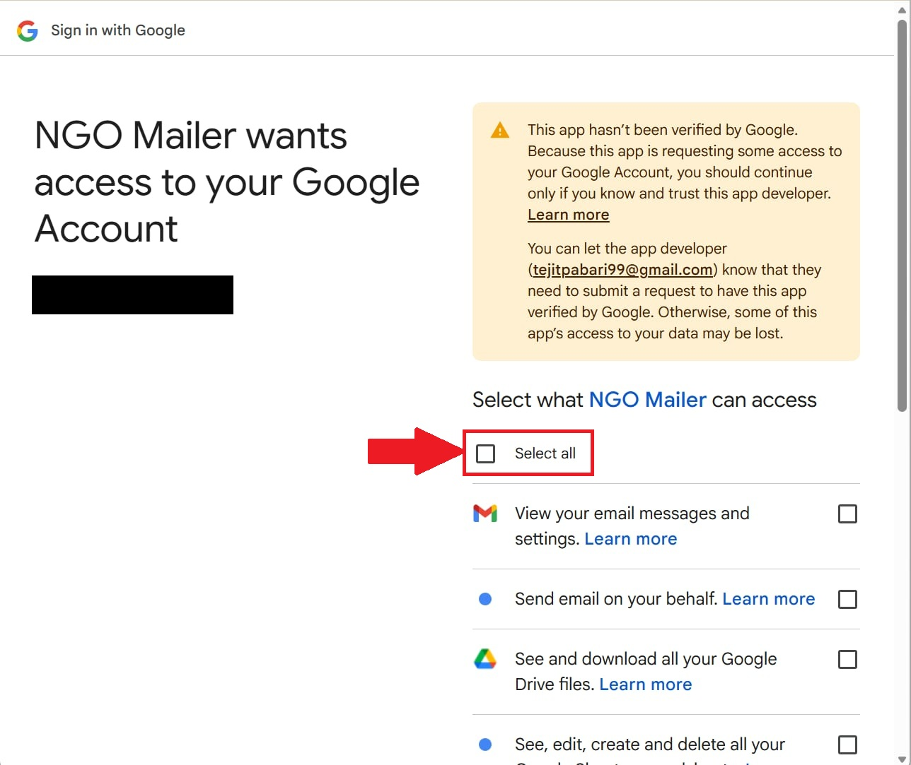
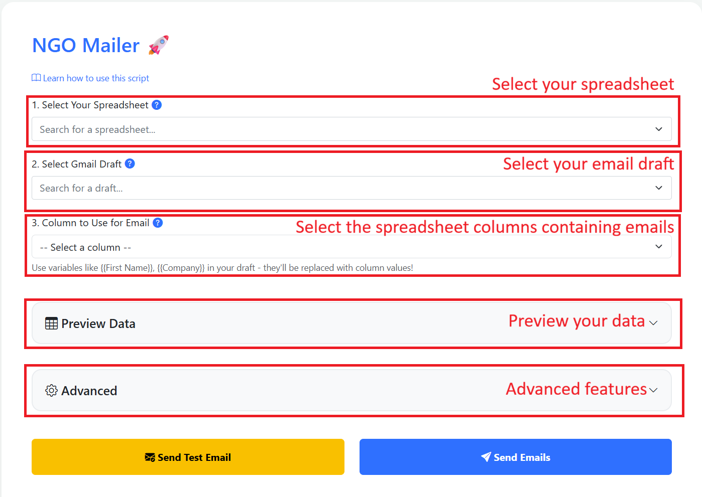
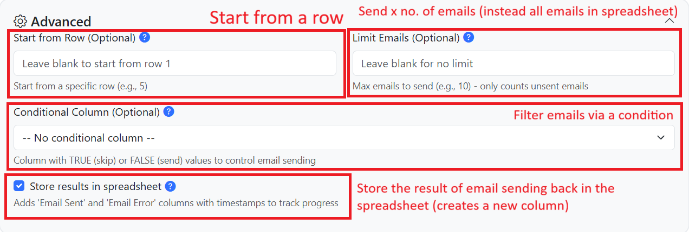

# NGO Auto Emailer — Installation and How-To Guide

_Updated November 2026: choose a tab, safer dashboard._

**Open the tool:** <https://script.google.com/macros/s/AKfycbw3OyqV-_Q4ubNhc4Rwjz0YeS3lmKdCaITJx3rsnp9CFzLpMvWW2XilI9LNTHIXsmle/exec>

There is nothing to download or install. The tool is a web page that runs inside your own Google account. This guide walks you through setting it up the first time and sending your first batch of emails.

---

## What it does

The NGO Auto Emailer sends a personal email to many people at once, using a list in a Google Sheet.

- You write **one** email in Gmail and mark the parts that should change for each person, like `{{Full Name}}`.
- The tool sends that email to every person in your sheet and fills in **their** details.
- Example: "Dear `{{Full Name}}`" becomes "Dear Donor A" for one person and "Dear Donor B" for the next.

The emails are sent **from your own Gmail address**, just as if you had sent each one by hand.

---

## What you need

| You need | What it means |
|---|---|
| A Google account | Your Gmail address (personal or your organization's Google Workspace account). |
| A Google Sheet | Your list of people. One row per person, with at least one column of email addresses. |
| A Gmail draft | An email you wrote in Gmail and saved but did **not** send. It is your template. |

### Daily sending limits (set by Google)

| Account type | About how many emails per day |
|---|---|
| Personal Gmail (`@gmail.com`) | about **100** |
| Google Workspace (organization account) | about **1,500** |

If you have more people than that, send in batches over several days. See [Advanced options](#advanced-options) for how to do this safely.

---

## Step 1 — Set up your Google Sheet

1. Open [Google Sheets](https://sheets.google.com) and create a new sheet (or open your existing list).
2. Put the **column names** in the **first row**. For example: `Full Name`, `Email`, `Personal Note`.
3. Keep column names short and simple. Use only letters, numbers and spaces. Avoid symbols like `#`, `{`, `}`, `/`.
4. Make sure you have a column with **email addresses**.
5. Put one person per row, starting from row 2.
6. Your list can be on **any tab** of the spreadsheet. You pick the tab in the dashboard (see Step 5). If you do not pick one, the tool uses the first tab.

> **Important:** The file must be a real **Google Sheet**, not an uploaded Excel (`.xlsx`) or `.csv` file.
> If your file name shows a green `.XLSX` badge, open it and click **File → Save as Google Sheets**. Use the new copy.

**Example sheet:**

| Full Name | Email | Personal Note | Last donated year |
|---|---|---|---|
| Donor A | donor.a@example.com | It was nice meeting you during the fundraiser. | 2025 |
| Donor B | donor.b@example.com | | 2023 |
| Donor C | donor.c@example.com | It was nice to see you during the annual gala last year. | 2021 |

Want a ready-made example? Download [sample-sheet.csv](docs/sample-sheet.csv), then in Google Sheets click **File → Import → Upload** and pick that file.

---

## Step 2 — Write your email as a Gmail draft

A **Gmail draft** is an email you write in Gmail and save without sending. Gmail saves it automatically in the **Drafts** folder.

1. Open [Gmail](https://mail.google.com) and click **Compose**.
2. Leave the **To** box empty. The tool fills it in for each person.
3. Type a **Subject**. Make it **different from every other draft** you have. The tool finds your draft by its subject, so two drafts with the same subject can get mixed up.
4. Write your email.
5. Wherever you want a person's own details, type the **column name** inside double curly brackets: `{{` before and `}}` after.
   - Type the column name **exactly** as it is in row 1 of your sheet.
   - Do **not** add spaces inside the brackets: write `{{Full Name}}`, not `{{ Full Name }}`.
6. You can also use them in the **subject line**, for example `Thank you, {{Full Name}}!`. **But** a placeholder in the subject is only filled in if the **same** `{{...}}` also appears somewhere in the **email body**. If it is only in the subject, it comes out blank.
7. You may add **attachments** and **pictures**. They are sent to everyone.
8. Close the draft. Gmail saves it automatically.

**Example draft** (using the example sheet above):

```
Subject: Thank you for your support, {{Full Name}}

Dear {{Full Name}},

{{Personal Note}} Thank you for your contribution to the organization. Your
previous donation in {{Last donated year}} was really helpful in furthering
our mission to save trees.

This year our target is $200,000 before our annual gala in August, for which
you are cordially invited.

Regards,
NGO Director
```

<!-- SCREENSHOT NEEDED: gmail-draft-variables -->
_(Picture coming soon: a Gmail draft with `{{Full Name}}`-style placeholders.)_

---

## Step 3 — Open the tool

1. Click this link: <https://script.google.com/macros/s/AKfycbw3OyqV-_Q4ubNhc4Rwjz0YeS3lmKdCaITJx3rsnp9CFzLpMvWW2XilI9LNTHIXsmle/exec>
2. Tip: bookmark it so you can find it again.
3. If you are signed in to more than one Google account, Google asks which one to use. Pick the account that has your sheet and your draft.

<!-- SCREENSHOT NEEDED: choose-account -->
_(Picture coming soon: Google's "Choose an account" screen.)_

---

## Step 4 — Give permission (first time only)

The first time you open the tool, Google asks you to allow it. You only do this **once**.

**Why Google shows a warning:** the tool has not gone through Google's paid review process for public apps. That is why Google calls it "unverified". It is safe to continue if you trust the person who shared it with you.

**Safety check before you continue:** only go on if **both** are true:

- You opened the tool from the link in this guide, **and**
- Google's screen shows the developer as **tejitpabari99@gmail.com**.

If it shows any other address, click **Back to safety** and do not continue.

**How your data is handled:** the tool runs **as you, from your own Google account**. See [Privacy](#privacy) for the full, honest details.

1. Click **Review permissions**.

   

2. Google shows "Google hasn't verified this app". Click **Advanced** (small link, bottom left).

   

3. Click **Go to NGO Mailer (unsafe)**.

   

4. Tick **Select all** so every permission is allowed. The tool will not work if any are left unticked.

   

5. Scroll down and click **Continue**.

<!-- SCREENSHOT NEEDED: continue-allow -->
_(Picture coming soon: the Continue button at the bottom of the permission screen.)_

**What each permission is for:**

| Google asks to… | Why the tool needs it |
|---|---|
| See your Google Drive files (read only) | This lets the tool see and download **all** your Drive files. The tool only lists your spreadsheets and reads the one you pick. |
| View your email messages and settings (read only) | This lets the tool read **all** your email. The tool only reads your drafts, to find your template. |
| Send email on your behalf | To send the emails, from your address. |
| See, edit, create and delete your spreadsheets | To read your list and (if you choose) write the "Email Sent" results back into it. |
| See your primary Google Account email address | To send the **test email** to you. |

---

## Step 5 — Fill in the dashboard

After permission, you see the **NGO Mailer** dashboard.



> The picture above is from an earlier version and does not show the new **Select Tab** list yet.

<!-- SCREENSHOT NEEDED: dashboard-with-tab -->
_(Picture coming soon: the dashboard showing the new Select tab list)_

1. **Select Your Spreadsheet** — click the box and start typing your sheet's name to search for it.
2. **Select Tab** — pick the tab (sheet) inside that spreadsheet that has your list of people. It fills in after you pick a spreadsheet, and the first tab is chosen for you. If your list is on a different tab, change it here.
3. **Select Gmail Draft** — pick the draft you wrote in Step 2 (shown by its subject).
4. **Column to Use for Email** — pick the column that holds the email addresses (for example `Email`). This list fills in after you pick a tab.
5. **Preview Data** — click to open it. It shows the first 5 rows of the tab you picked so you can check you chose the right list.

<!-- SCREENSHOT NEEDED: preview-data-expanded -->
_(Picture coming soon: the Preview Data section opened, showing sheet rows.)_

---

## Step 6 — Always send a test email first


1. Click **Send Test Email**.
2. The tool sends **one** email, **only to you**, using the details from the **first person** in your sheet (row 2). Nobody on your list gets anything.
3. Open your inbox. Look for an email whose subject starts with **[TEST]**.
4. Check that every `{{...}}` was replaced with real details. If you still see `{{...}}` or a blank space, see [Troubleshooting](#troubleshooting).

<!-- SCREENSHOT NEEDED: test-email-inbox -->
_(Picture coming soon (optional): the test email as it arrives in your inbox.)_

---

## Step 7 — Send the emails

1. Click **Send Emails**.
2. A box asks you to confirm. Click **OK**.
3. The button shows progress, for example "Sending 12/40 (30%)".
4. **Keep this browser tab open** until it says **Complete!** The tab sends the emails one by one. If you close the tab or your computer goes to sleep, sending stops. (You can safely pick up where you left off — see [How to continue after stopping](#how-to-continue-after-stopping).)
5. When it says **Complete!** it shows how many were sent and how many failed.

If **Store results in spreadsheet** is ticked (it is, by default), the tab you picked gets two new columns showing what happened for each person:

<!-- SCREENSHOT NEEDED: sheet-result-columns -->
_(Picture coming soon: the spreadsheet with the new "Email Sent" and "Email Error" columns.)_

---

## Advanced options

Click **Advanced** on the dashboard to open these. All are optional.



| Option | What it does | When to use it |
|---|---|---|
| **Start from Row** | Starts sending from a given person. `1` means the first person (the row just under the column names, row 2 in the sheet). `5` means the fifth person. Leave blank to start from the top. | You already sent to the first few people and want to skip them. |
| **Limit Emails** | Sends to at most this many people, then stops. It counts people the tool will **try** to email. Rows marked TRUE in the Conditional Column are not counted. Rows with no email address, or where the send fails, **still count**. Leave blank for no limit. | You are close to the daily limit, or you want to send in small batches. |
| **Conditional Column** | Pick a column that says whether each person **already got** the email. **TRUE** = already sent, **skip** this person. **FALSE** or **empty** = **send** to this person. Capital or small letters both work. Any other value (like "yes") stops the run with an error. | You only want to email some people, or you are continuing a send that stopped. |
| **Store results in spreadsheet** | Ticked by default. Each run adds two new columns at the end of your sheet: **Email Sent &lt;date and time&gt;** (TRUE if sent, FALSE if not) and **Email Error &lt;date and time&gt;** (the reason, if it failed). | Keep it on, so you have a record of who got the email. |

**Safety stop:** if **5 emails in a row** fail, the tool stops and tells you the last error, so a mistake does not repeat for your whole list.

### How to continue after stopping

Pick **one** of these:

- **Simplest:** note the number of the last person who got the email. Next time, set **Start from Row** to the next number.
- **Or keep one column of your own** (for example `Already Sent`, like in the [sample sheet](docs/sample-sheet.csv)):
  1. After each run, copy the **TRUE** values from that run's **Email Sent &lt;date and time&gt;** column into your `Already Sent` column.
  2. Next time, set **Conditional Column** to `Already Sent`.

Do **not** use the newest **Email Sent** column as the Conditional Column on its own. People skipped in that run are not written into it, so they would be emailed again on the next run.

After adding or changing columns, **refresh the tool's page** and pick your spreadsheet again so the new columns show up in the dropdowns.

---

## Troubleshooting

| Problem | What to do |
|---|---|
| My spreadsheet is not in the list. | The list shows up to 50 sheets, and the search box only searches those 50. If yours is missing, make a copy of it (**File → Make a copy**) or remove old sheets you do not need, then refresh the page. Also check it is a real Google Sheet, not an `.xlsx` file (see Step 1). |
| My draft is not in the list, or I get "Draft … not found". | Make sure it is still in Gmail's **Drafts** folder (not sent or deleted). Refresh the tool's page. Make sure no other draft has the same subject. |
| A `{{...}}` came out blank in the email. | The name inside the brackets does not match a column name. Check spelling and spaces against row 1 of your sheet, and remove any spaces just inside the brackets. Also check that cell is not empty for that person. If it is in the **subject**, the same `{{...}}` must also appear in the email body. |
| "Tab ... not found in this spreadsheet". | The tab was renamed or deleted after you picked it. Refresh the page, pick the spreadsheet again, then pick the tab. |
| "No email address" in the error column. | That person's email cell is empty. Fill it in, then continue (see above). |
| "Invalid conditional column value". | The Conditional Column must contain only TRUE, FALSE or nothing. Fix the odd cell, or pick a different column. |
| Emails stopped partway / quota or limit error. | You probably reached Google's daily limit (about 100 personal, 1,500 Workspace). Wait 24 hours, then continue (see above). |
| "Authorization required" or a permission error. | Open the tool link again and repeat [Step 4](#step-4--give-permission-first-time-only). Make sure **Select all** was ticked. |
| It stopped after 5 errors. | Read the last error shown, and the **Email Error** column in your sheet. Fix the cause, then continue. |
| The page shows "Error Loading Application". | Refresh the page. If it keeps happening, contact the person who shared this tool with you and include the error text. |

---

## Privacy

- The tool runs **as you, from your own Google account**. It reads your spreadsheet and your Gmail draft, sends the emails from your Gmail, and (if you choose) writes results back into your sheet.
- The current code is public in this repo, and it does **not** send your data to the developer or any other company.
- Google keeps basic **run logs** in the developer's Google project. Since the November 2026 update, the tool's own log lines no longer include your email address, your draft's subject, your sheet name or your recipients' email addresses. They only record things like counts, row numbers and error messages. Error messages can contain text that Google itself provides (for example a rejected address), so logs are not guaranteed to be free of personal details.
- The developer can change the tool's code later. The code is public here, so anyone can check it.
- You can remove its access at any time at <https://myaccount.google.com/permissions> (look for **NGO Mailer**).
